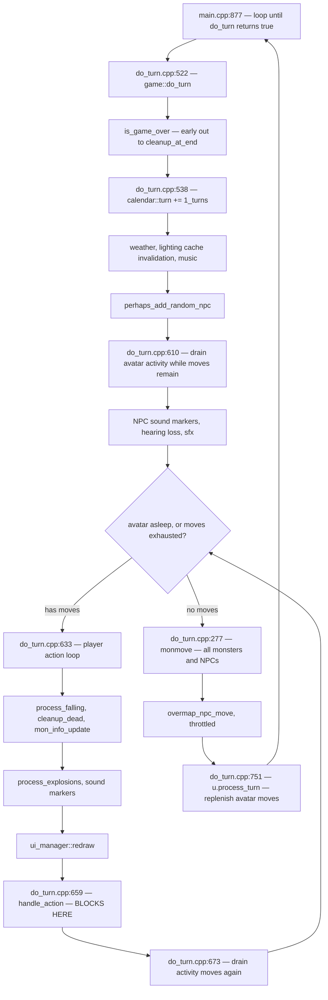
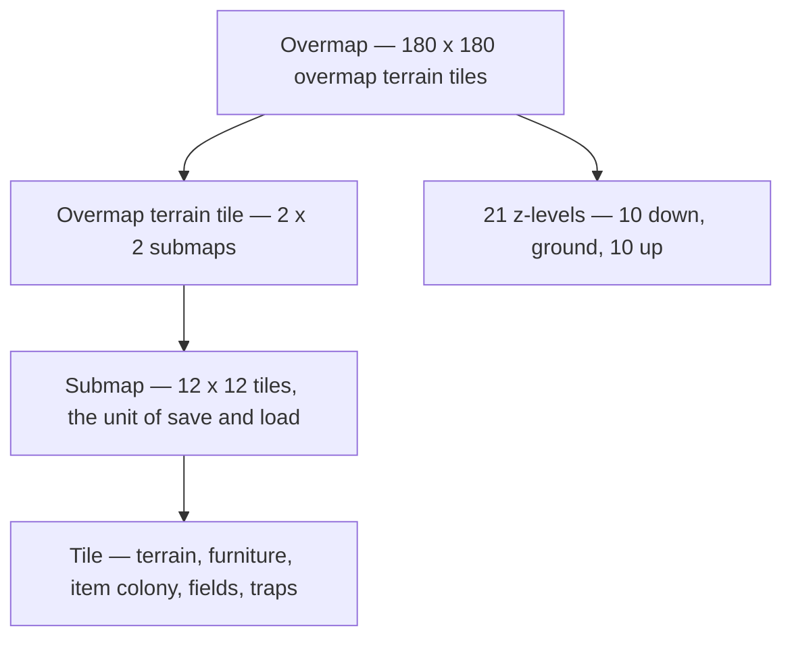
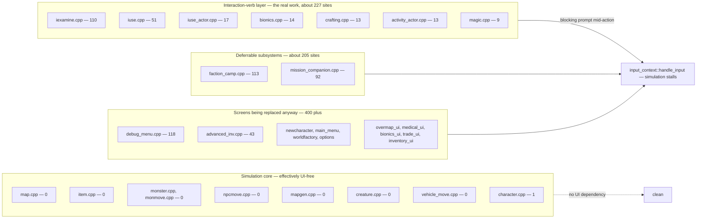
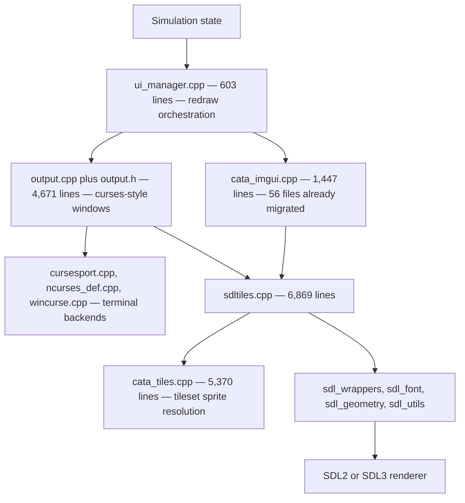

# Architecture As-Is

**Status:** current as of commit `b9a8c7aa2c` (2026-10-26)
**Scope:** how the game works *today*, as a baseline for the real-time conversion.
**Method:** derived by reading the source directly. Every non-obvious claim cites `file:line`. No measurements in this document are from memory; the commands used are in the [appendix](#appendix-verification-commands) so they can be re-run when the tree moves.

This document describes reality, not intent. Design decisions and the target architecture belong in their own documents.

---

## 1. Executive summary

Five findings shape everything downstream.

1. **The game is already a fixed-tick simulation.** One tick is one second of game time. It is not an event-driven or continuous-time system. The real-time conversion is therefore a *pacing and input* change, not a simulation rewrite.

2. **Only one thing makes it turn-based.** Inside each tick, `handle_action()` performs a blocking read on the input queue and will not return until the player presses something. Remove that blocking property and the tick is free-running.

3. **The simulation core is almost free of UI calls.** `map.cpp`, `item.cpp`, `monster.cpp`, `monmove.cpp`, `npcmove.cpp`, `mapgen.cpp`, `creature.cpp` and `vehicle_move.cpp` contain **zero** blocking UI call sites; `character.cpp` has one. The blocking prompts are concentrated in the *interaction-verb* layer, and that set is finite and enumerable.

4. **Move points already bank across ticks.** `moves += get_speed()` accumulates; it does not reset. The action economy is a credit balance, not a per-turn allowance. This has direct consequences for real-time pacing.

5. **Gamepad input and a modern UI toolkit are already in-tree.** `sdl_gamepad.cpp` already maps an analog stick to grid directions, and 56 files already render through ImGui. Neither needs to be introduced from scratch.

---

## 2. The simulation loop

The entire game is a tight loop over one function. `main.cpp:877`:

```cpp
while( !g->do_turn() ) {}
```

`game::do_turn()` lives in `do_turn.cpp:522` and returns `true` only when the game is over. There is no frame loop, no fixed timestep accumulator, and no wall-clock pacing anywhere in it. The loop runs as fast as the blocking input read allows.



### 2.1 The blocking point

`do_turn.cpp:630-633` guards the player's slice of the tick:

```cpp
// avatar processes human input through handle_action()
if( !u.has_effect( effect_sleep ) || uquit == QUIT_WATCH ) {
    if( u.get_moves() > 0 || uquit == QUIT_WATCH ) {
        while( u.get_moves() > 0 || uquit == QUIT_WATCH ) {
```

Within that loop, `handle_action()` (`handle_action.cpp:3252`) resolves an input event to an `action_id` and executes it. It reaches `input_context::handle_input()`, which does not return until input arrives. **The world is frozen for exactly as long as the player is thinking.**

Note the loop condition: it runs `while` the avatar has moves, so a player whose action costs fewer than their accumulated moves acts **multiple times within a single tick**, with no simulation advance between those actions.

### 2.2 A real-time path already exists

`do_turn.cpp:233`, `handle_key_blocking_activity()`, is the fallback taken when the avatar has no moves left — typically mid-activity. The `else` branch that calls it is rate-limited to 10 Hz by a `steady_clock` comparison. This is a non-blocking input poll running against a free-advancing simulation: the real-time loop already exists in the codebase, as the exceptional path rather than the default. It is the natural template to generalise.

---

## 3. Time and the action economy

### 3.1 Ticks

| Concept | Value |
| --- | --- |
| Tick length | `1_turns` = 1 second of game time (`do_turn.cpp:538`) |
| Time representation | `time_point` / `time_duration` wrapping an `int` turn count (`calendar.h:204`, `calendar.h:470`) |
| Throttling idiom | `calendar::once_every( N )` for sub-tick-rate subsystems |

All content timings — crafting durations, item use times, activity lengths, effect durations — are denominated in turns or moves. **A tick that stays one game-second keeps all 6,566 JSON data files valid.** Changing the tick's game-time meaning would invalidate the entire content corpus; changing its *wall-clock* rate costs nothing.

### 3.2 Move points

Every `Creature` holds `int moves` (`creature.h:1240`), accessed through `get_moves()` / `mod_moves()` / `set_moves()` (`creature.h:729-731`).

Replenishment, `creature.cpp:395`:

```cpp
void Creature::process_turn()
{
    process_turn_no_moves();

    // add an appropriate number of moves
    if( !has_effect( effect_ridden ) ) {
        moves += get_speed();
    }
}
```

`Character` overrides this (`character.cpp:2231`) because speed is not yet computed when the base version runs; it calls `process_turn_no_moves()`, then `recalc_speed_bonus()`, and adds moves at `character.cpp:2275`.

Three properties matter for the conversion:

- **Speed is moves-per-tick.** 100 is baseline; `get_speed()` = `get_speed_base() + get_speed_bonus()` (`creature.cpp:2403`).
- **Moves accumulate, they do not reset.** The `+=` means unspent moves carry forward indefinitely. A player who idles builds a credit balance and can then burst several actions in one tick.
- **Moves can go negative.** Actions costing more than the current balance drive it below zero, and the creature simply skips ticks until it recovers.

Property two is the sharpest real-time hazard. Under a blocking read, banked moves are invisible — the player cannot idle, because the world waits for them. Under a free-running tick, an idle player silently accrues a burst-action reserve. **This is design decision #1 and it is load-bearing for combat feel.**

---

## 4. Spatial model

All constants from `map_scale_constants.h`.



| Constant | Value | Meaning |
| --- | --- | --- |
| `SEEX` / `SEEY` | 12 | Submap edge in tiles |
| `MAPSIZE` | 11 | Reality bubble edge in submaps |
| `MAPSIZE_X` / `MAPSIZE_Y` | 132 | Reality bubble edge in tiles |
| `MAX_VIEW_DISTANCE` | 60 | View and hard ranged-attack cap (`RANGE_HARD_CAP`) |
| `OMAPX` / `OMAPY` | 180 | Overmap edge in overmap terrain tiles |
| `OVERMAP_DEPTH` / `OVERMAP_HEIGHT` | 10 / 10 | Z-levels below / above ground |
| `OVERMAP_LAYERS` | 21 | Total z-levels |
| `SEG_SIZE` | 32 | Save directory granularity, in submaps |

The **reality bubble** is the 132x132x21 region around the player that is actively simulated. Everything outside it is dormant, persisted as submaps, and fast-forwarded on reload. This is a hard architectural boundary and a significant asset: it already bounds per-tick simulation cost independently of world size.

Coordinates are strongly typed (`coordinates.h`) — `tripoint_bub_ms`, `point_sm_ms` and friends distinguish bubble-relative, submap-relative and absolute spaces at compile time. Item storage is `cata::mdarray<cata::colony<item>, point_sm_ms>` per submap (`submap.h:66`).

**The grid is load-bearing.** Shadowcasting FoV, A* pathing, melee reach, vehicle part layout, field spread and mapgen all assume integer tile coordinates. Moving to continuous float positions would invalidate all of them simultaneously.

---

## 5. Vision, lighting and sound

| System | Location | Size |
| --- | --- | --- |
| Shadowcasting FoV | `shadowcasting.cpp` | 682 lines |
| Lightmap / illumination | `lightmap.cpp` | 1,746 lines |
| Sound propagation and markers | `sounds.cpp` | 2,112 lines |

Lighting is invalidated per tick for every z-level in `do_turn()` via `m.set_lightmap_cache_dirty( z )`, then recomputed lazily. Sound is modelled as discrete events converted to "sound markers" for display, processed at several distinct points in the tick — notably both before and after the player acts, so the player can register noises they caused. The marker lifecycle assumes a discrete turn boundary (`sounds::reset_markers()` is called once the player's slice ends) and will need revisiting under a free-running tick.

---

## 6. The activity system

Long multi-tick tasks run through `player_activity` (`player_activity.h:33`), which holds:

- `activity_id type` — the kind of activity
- `int moves_total` (`player_activity.h:46`)
- `int moves_left`, defaulting to `calendar::INDEFINITELY_LONG` (`player_activity.h:48`)
- a `std::unique_ptr<activity_actor>` carrying behaviour and state

| Metric | Count |
| --- | --- |
| `activity_actor` subclasses | 92 (`activity_actor_definitions.h`) |
| Distinct `ACT_*` identifiers | 130 |
| `activity_actor.cpp` | 15,063 lines — the second-largest file in `src/` |

Activities are drained at two points per tick (`do_turn.cpp:610` and `do_turn.cpp:673`), both guarded by `while( u.get_moves() > 0 && u.activity )`.

This system is simultaneously the most real-time-ready part of the game and the biggest *gameplay* problem. Mechanically it is already a time-sliced task that consumes a move budget across ticks — exactly the right shape. Experientially it is the source of the "press key, wait" loop, and under wall-clock pacing that waiting acquires real cost. Making the game more fun will require redesigning activity *presentation* and interruption, not the underlying mechanism.

---

## 7. Where the UI blocks the simulation

Counting call sites of `query_yn`, `query_int`, `popup`, `popup_getkey`, `query_popup`, `string_input_popup` and `uilist` across `src/` excluding `third-party/`: **1,063 total.**

That headline number is misleading. The distribution is what matters.



### 7.1 Why the shape is favourable

The simulation core — the part that is genuinely hard to rewrite and that holds the systems worth keeping — does not call UI at all. The blocking calls sit in the layer that translates *player intent* into *world change*: examining a thing, using an item, installing a bionic, starting a craft. That layer is where prompts naturally belong, and it is a bounded list of roughly 227 sites across seven files.

### 7.2 Why it is still the long pole

Each of those 227 sites is a synchronous question asked from the middle of a state mutation. `iexamine` functions routinely prompt, branch on the answer, and mutate the map in one straight-line call. Converting them means inverting control flow — the verb must become resumable, either as a state machine, a coroutine, or a continuation handed to the frontend. That is mechanical but genuinely invasive work, and `iexamine.cpp` alone holds 110 of them.

A secondary cluster deserves separate note: `computer_session.cpp` has 58 direct input-wait call sites, the highest of any file. It implements terminal-hacking minigames as fully blocking modal loops, and is effectively its own tiny game. It should be treated as a rewrite target, not a refactor target.

---

## 8. Rendering stack



| Component | Lines | Role |
| --- | --- | --- |
| `sdltiles.cpp` | 6,869 | SDL window, event pump, framebuffer management |
| `cata_tiles.cpp` | 5,370 | Tileset lookup, sprite layering, animation |
| `output.cpp` + `output.h` | 4,671 | Legacy curses-style window abstraction |
| `cata_imgui.cpp` | 1,447 | ImGui integration layer |
| `panels.cpp` | 887 | Sidebar widget rendering |
| `ui_manager.cpp` | 603 | Redraw stack and invalidation |

Two facts stand out.

**The dual-backend abstraction is pervasive and costly.** `output.h` is included by **175** files, and there are **180** `TILES` conditional-compilation directives across 63 files. Everything drawn must be expressible both as a character grid and as sprites, which caps what the renderer can express. Deleting the terminal backend is pure subtraction and unlocks the renderer.

**The modern UI layer is already adopted.** 56 files render through `cata_imgui`, including `crafting_gui.cpp`, `advanced_inv.cpp`, `medical_ui.cpp`, `newcharacter.cpp` and `popup.cpp`. The migration away from the legacy window layer is underway, not hypothetical. Separately, `sound_backend_sdl3.cpp` exists alongside `sound_backend_sdl2.cpp`, so SDL3 is already a supported target.

---

## 9. Input stack

| Component | Lines | Role |
| --- | --- | --- |
| `input_context.cpp` | 1,549 | Context-scoped keybinding resolution, blocking `handle_input()` |
| `action.cpp` | 1,318 | `action_id` dispatch |
| `input.cpp` | 1,027 | Device events, keybinding persistence |
| `sdl_gamepad.cpp` | 933 | SDL gamepad and controller abstraction |
| `handle_action.cpp` | 3,488 | The action switch — intent to world change |

`action.h` defines **159** `ACTION_*` identifiers. Input flows: SDL event → `input_manager` → `input_context::handle_input()` (blocking) → `action_id` → `game::handle_action()` switch.

**Gamepad support already exists and is wired in.** `sdl_gamepad.cpp` wraps SDL's gamepad API — both sticks, both triggers, the full button set — and `handle_action.cpp:3329` already consumes it:

```cpp
if( gamepad::is_active() ) {
    gamepad::direction dir = gamepad::get_left_stick_direction();
    if( dir != gamepad::direction::NONE ) {
        tripoint offset = gamepad::direction_to_offset( dir );
```

The analog-stick-to-grid-step pattern is therefore already implemented. The gap is not device support; it is that input is consumed through a blocking, modal, 159-action keyboard-shaped vocabulary. A controller has roughly 16 buttons. **The real controller problem is the action vocabulary and the modal menus, not the hardware.**

---

## 10. Content pipeline

| Metric | Value |
| --- | --- |
| JSON data files | 6,566 |
| `data/json` (core content) | 50 MB |
| `data/mods` | 46 MB across 48 directories |
| `data/core` | 124 KB |
| JSON type registrations in `init.cpp` | 188 |
| `item_factory.cpp` | 5,435 lines |
| `mod_manager.cpp` | 547 lines |

`init.cpp` registers 188 distinct JSON-loadable types, each with a deserialisation function. Core content loads through the same moddable pipeline as mods — "core" is structurally just a privileged mod set.

This has a specific consequence for the plan: **removing mod *support* saves little code** (`mod_manager.cpp` is only 547 lines), but **removing mod *content* halves the data surface** — 46 MB of 96 MB total, and with it the entire mod-compatibility matrix, load-order resolution, and a long tail of content edge cases. The win is in compatibility surface and content volume, not lines of code.

---

## 11. Persistence

| Component | Lines |
| --- | --- |
| `savegame_json.cpp` | 5,813 |
| `savegame.cpp` | 2,236 |
| `savegame_legacy.cpp` | 247 |

Saves are JSON, written per-submap at `SEG_SIZE` (32-submap) directory granularity, with a versioned migration path. Every serialised duration and timestamp is in turns.

Because save data is turn-denominated and the tick keeps its one-game-second meaning, **a wall-clock pacing change does not break save compatibility.** Any change to the move-banking rules, however, alters the meaning of a persisted `moves` value and of every in-flight `player_activity.moves_left`.

---

## 12. Tests

247 test files in `tests/`. Coverage is strongest exactly where it is most useful for this project: the simulation core — map, items, crafting, combat math, vehicles. Because that core is UI-free, the test suite remains valid through a frontend replacement and is the primary safety net for the conversion. Tests that drive UI or assume blocking input are the ones that will break.

---

## 13. Implications for the conversion

Recorded here only as consequences of the above; the plan itself belongs in its own document.

**Favourable:**

- The tick is already fixed-rate and already means one game-second. Pacing it to wall clock is a change in the loop at `main.cpp:877`, not a simulation rewrite.
- The reality bubble already bounds per-tick cost at 132x132x21 regardless of world size.
- The simulation core has no UI dependency, so it can be driven by a new frontend without being rewritten.
- Gamepad input, ImGui and an SDL3 backend are all already present.
- A non-blocking input poll against a free-running simulation already exists at `do_turn.cpp:233`.
- 247 test files cover the systems worth keeping and survive a frontend swap.

**Costly:**

- ~227 blocking prompts in the interaction-verb layer must become resumable. `iexamine.cpp` holds 110 of them.
- 175 files include `output.h`; 180 `TILES` conditionals across 63 files must be collapsed, plus ~35 `TUI`/`IMTUI` directives across 11 files.
- `computer_session.cpp` (58 blocking input waits) needs rewriting, not refactoring.
- The 159-action keyboard vocabulary does not map onto a controller and needs redesign.
- Sound-marker lifecycle assumes a discrete player turn boundary.

**Open questions that the code cannot answer** — these are design decisions, carried into the decision log:

1. **Move banking.** Moves currently accumulate without bound. Under a free-running tick, do they bank, decay, cap, or convert to an action cooldown? This single choice determines combat feel more than any other.
2. **Multi-action ticks.** The player loop runs while moves remain, so fast actions already resolve several-per-tick with no world advance between them. Is that preserved, or does each action yield to the simulation?
3. **Pause semantics.** Is there an explicit pause, a slow-motion state, or an auto-pause on threat?
4. **Activity interruption.** Long activities are the main fun problem, and wall-clock pacing makes waiting genuinely expensive.
5. **Tick rate.** One game-second per tick is fixed by the content. How many wall-clock milliseconds per tick, and is it variable?

---

## Appendix: verification commands

Re-run these from `src/` to confirm the measurements as the tree moves.

```bash
# Blocking UI call sites, total and by file
grep -rnE '\b(query_yn|query_int|popup|popup_getkey|query_popup|string_input_popup|uilist)\s*\(' \
  --include='*.cpp' --include='*.h' . | grep -v '^./third-party/' | wc -l

grep -rcE '\b(query_yn|query_int|popup|popup_getkey|query_popup|string_input_popup|uilist)\s*\(' \
  --include='*.cpp' . | grep -v '^./third-party/' | grep -v ':0$' | sort -t: -k2 -rn | head -35

# Raw input-wait sites by file
grep -rnE '(handle_input|get_input_event|\bgetch\b|query_any)\s*\(' --include='*.cpp' . \
  | grep -v '^./third-party/' | awk -F: '{print $1}' | sort | uniq -c | sort -rn | head -25

# Legacy UI coupling
grep -rl '#include "output.h"' --include='*.cpp' --include='*.h' . | grep -v '^./third-party/' | wc -l
grep -rn 'defined(TILES)\|ifdef TILES\|TILES)' --include='*.cpp' --include='*.h' . | grep -v '^./third-party/' | wc -l

# ImGui adoption
grep -rl 'cata_imgui' --include='*.cpp' . | grep -v '^./third-party/' | wc -l

# Activity actors and JSON types
grep -cE 'class [a-z_]+ : public activity_actor' activity_actor_definitions.h
grep -oE 'add\( "[a-z_A-Z]+"' init.cpp | wc -l

# Content surface
find ../data -name '*.json' | wc -l
du -sh ../data/json ../data/mods ../data/core
```
