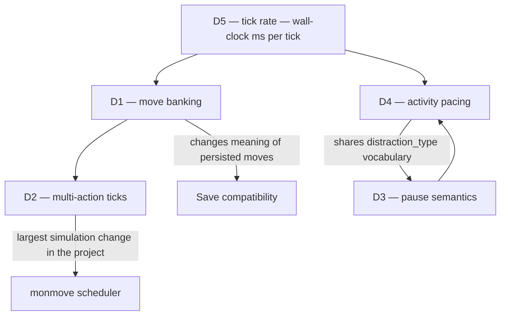

# Decision Log

**Status:** **all five decided.** D1, D2, D5 on 2026-10-26; D3, D4 on 2026-10-27. Docs 02 and 05 are unblocked.
**Baseline:** commit `b9a8c7aa2c` (2026-10-26).
**Prerequisite reading:** [01 — Architecture as-is](01-architecture-as-is.md).

These are the five questions the source code cannot answer. Each one is a design choice whose consequences propagate into the target architecture, so they are recorded before doc 02 is written rather than after.

Conventions: every "today" claim cites `file:line`. Rejected options are kept with their reasoning, because the reasons tend to resurface. Each decision ends with a recommendation and the consequences of taking it.

---

## Index

| # | Decision | Recommendation | Reversibility |
| --- | --- | --- | --- |
| [D1](#d1--move-point-banking) | Move-point banking | **DECIDED — cap at `speed * 1.5`, uniform** | Easy — one clamp |
| [D2](#d2--multi-action-ticks) | Multi-action ticks | **DECIDED — drain for spike, scheduler as target** | Hard — scheduler rewrite |
| [D3](#d3--pause-semantics) | Pause semantics | **DECIDED — hard pause on modal UI, plus auto-pause** | Moderate |
| [D4](#d4--activity-pacing-and-interruption) | Activity pacing | **DECIDED — time-scale multiplier; no content rebalance** | Easy — pacer-local |
| [D5](#d5--tick-rate) | Tick rate | **DECIDED — 250 ms, 4 ticks/sec** | Easy if constant from day one |

### Dependencies



D5 should be settled first: it converts every move cost into a wall-clock duration, which is the unit the other four are argued in.

---

## D1 — Move-point banking

**Status:** **DECIDED 2026-10-26 — cap accumulation at `speed * 1.5`, applied uniformly to the avatar, NPCs and monsters.**

See [Decision](#d1-decision) below; context and options are retained as the record of why.

### Context

Every `Creature` accumulates move points once per tick. `creature.cpp:395`:

```cpp
void Creature::process_turn()
{
    process_turn_no_moves();
    if( !has_effect( effect_ridden ) ) {
        moves += get_speed();
    }
}
```

`Character` does the same at `character.cpp:2275` after `recalc_speed_bonus()`. Three properties follow:

- `+=`, not `=`. **Unspent moves accumulate without bound.**
- Balances may go negative; a creature that overspends simply skips ticks until it recovers.
- `get_speed()` is moves-per-tick, baseline 100 (`creature.cpp:2403`).

Measured speed distribution across the 612 core monsters that declare `speed` explicitly:

| Statistic | Value |
| --- | --- |
| Minimum | 0 |
| Median | 100 |
| Maximum | 500 — `mon_yrax_apeirogon` |
| Modal band | 100–124, 206 monsters |
| Reference points | `mon_zombie_crawler` 20, `mon_zombie_tough` 85, `mon_zombie_brute` 105, `mon_bear` 140, `mon_dog` 150, `mon_wolf` 165, `mon_deer` 300 |

Under blocking input, unbounded banking is **invisible**: the player cannot idle, because the world is already stopped waiting for them. Remove the block and the property becomes live. At 100 speed and a 250 ms tick, a player who stands still for 10 wall-clock seconds banks 4,000 moves — roughly 40 queued actions, dischargeable instantly. That is not a balance wrinkle; it is a dominant strategy.

### Options

**A. Hard reset each tick** — `moves = get_speed()`.
Eliminates banking entirely. Simple and fully predictable. Costs the ability to pay for actions exceeding one tick's allowance in advance, and more importantly discards sub-tick carry: a player who acts slightly after a tick boundary silently forfeits the remainder, which reads as input lag.

**B. Cap accumulation** — `moves = min( moves + get_speed(), get_speed() * k )`.
Keeps the existing economy and all content denominations intact, bounds the exploit at `k` ticks of burst, and preserves carry so near-boundary input is not punished. Adds exactly one tunable. Negative balances still work unchanged.

**C. Decay toward zero** — exponential or linear bleed of unspent moves.
Smooth and exploit-free, but opaque: the player cannot predict their own action budget, and two tunables interact with speed. Hard to communicate in UI.

**D. Replace with per-action cooldowns** — discard move points; each action sets a lockout in milliseconds.
The most conventional action-game feel and the easiest to communicate. But move points are the denomination of **all** content: every item's `attack_time`, every activity's `moves_total`, all 612 monster speeds, and every persisted `moves` value in every save. This is a content-wide rewrite masquerading as a mechanics change.

**E. Leave unbounded.**
Rejected. It is a dominant strategy available for free by doing nothing, which is the worst possible shape for an exploit.

### D1 Decision

**Decided: Option B with `k = 1.5`, applied uniformly to the avatar, NPCs and monsters.**

```cpp
// Creature::process_turn, creature.cpp:395
moves = std::min( moves + get_speed(), static_cast<int>( get_speed() * 1.5 ) );
```

The same change is needed at `character.cpp:2275`, which duplicates the accumulation because `Character` must run `recalc_speed_bonus()` first.

At baseline speed 100 the cap is 150 moves, which at the D5 rate of 250 ms/tick is **375 ms of action credit** — enough to absorb input timing jitter, not enough to bank a combo. `k` stays a named constant so it can be tuned by feel.

Uniform application is part of the decision, not an implementation detail. Monsters and NPCs accumulate through the same `Creature::process_turn`, and capping only the avatar would silently rebalance every encounter in the game in the player's favour.

### Consequences

- Changes the meaning of a persisted `moves` value. Clamp on load; `savegame_json.cpp` needs a migration note, though no format change.
- Interacts directly with D2: banking capped at 1.5 ticks bounds the existing drain-until-empty player loop to roughly one or two actions, which makes D2's simplest option survivable for a first playable.
- Needs a visible action-budget indicator, or the cap is invisible and feels arbitrary.
- **Verified safe for slow creatures.** A capped creature can no longer save up for an action costing more than `speed * 1.5`; it must go into debt instead. That is safe because no action in the codebase gates on affording its full cost upfront — a search for upfront affordability checks found only `>= 0` loop guards (`pickup.cpp:406`, `monattack.cpp:1037`) and the activity-progress comparison at `player_activity.cpp:253`. Negative balances already work, and the `while( get_moves() > 0 )` guards at `do_turn.cpp:326` and `do_turn.cpp:633` already handle creatures that cannot act this tick.
- Worked example, `mon_zombie_crawler` at speed 20: cap 30, so a 100-move attack drops it to -70 and it recovers over about four ticks, attacking roughly once every five ticks. That is the intended cadence for a slow creature and matches its pre-cap behaviour.
- The `based_on_type::SPEED` activity branch at `player_activity.cpp:253` consumes the whole move balance per tick, so capped banking slightly slows speed-based activities for a character who was previously carrying a surplus into them. Minor, and in the direction of consistency.

---

## D2 — Multi-action ticks

**Status:** **DECIDED 2026-10-26 — keep drain-until-empty for the first playable; move-ordered scheduler is the declared target.**

The largest simulation-architecture question in the project. See [Decision](#d2-decision) below.

### Context

The player's slice of the tick is a drain loop, `do_turn.cpp:633`:

```cpp
while( u.get_moves() > 0 || uquit == QUIT_WATCH ) {
```

The player therefore resolves **as many actions as their balance affords, with no simulation advance between them.** A 25-move action at speed 100 resolves four times in a single game-second while every monster stands still.

Today this is hidden by the blocking read, which interleaves a human pause between actions. Under wall-clock pacing it becomes visible as the world freezing in bursts.

The underlying problem is a granularity mismatch. A 25-move action *should* take a quarter of a game-second. The simulation's finest unit is one game-second (`do_turn.cpp:538`). Sub-tick action timing is therefore **inherently unrepresentable** without changing the scheduler.

### Options

**A. Keep draining.**
Zero work. Once D1 caps banking, bursts are bounded to roughly `k` actions. Fast actions still resolve with no world response between them, so fast weapons feel like a free multi-hit rather than a faster cadence.

**B. One action per tick, bank the remainder.**
Dead simple and perfectly predictable: action rate equals tick rate. But it flattens the action economy — a 25-move attack and a 100-move attack both take one tick, so weapon speed stops mattering. That deletes a real and well-tuned axis of the combat system, which contradicts keeping the systems.

**C. Move-ordered scheduler.**
Replace the fixed player-then-monsters ordering with a priority queue over all creatures in the reality bubble, keyed on accumulated moves, so actions resolve in cost order and interleave within the tick. This is how real-time-with-ticks games actually work, and it makes a fast weapon genuinely faster rather than multiply-hitting.

Cost: `monmove()` (`do_turn.cpp:277`) and the whole tick structure get rewritten. Every ordering assumption in the current tick — sound markers processed before and after the player acts, `process_falling`, `cleanup_dead`, explosion processing — has to be re-situated relative to a scheduler rather than a fixed sequence. It also changes monster behaviour subtly everywhere, which the 247-file test suite will surface loudly.

### D2 Decision

**Decided: Option A for the first playable, Option C as the declared target.** Option B is rejected outright — flattening every action to one per tick would delete the weapon-speed economy, which is exactly the kind of system worth keeping.

**This is a knowingly incorrect intermediate state.** Recorded as such so it is not later mistaken for a finished design. Two guardrails follow from that:

1. D1's `k = 1.5` is tuned for input jitter, **not** as a workaround for Option A's burstiness. Do not retune it to paper over multi-action bursts; that is the scheduler's job.
2. The test-suite churn from Option C is budgeted now, not discovered later.

With D1's cap in place, Option A's burst is bounded to one or two actions per tick rather than the forty an uncapped balance allowed, which is what makes it survivable rather than broken.

### Scope of the scheduler stage

Option C replaces the fixed player-then-monsters sequence with a priority queue over creatures in the reality bubble, keyed on accumulated moves. The hard part is not the queue — it is that the current tick ordering encodes real meaning that becomes ill-defined once the player interleaves with monsters. The existing order, for the record:

| Phase | Work | Line |
| --- | --- | --- |
| Tick open | `calendar::turn += 1_turns` | `do_turn.cpp:538` |
| Pre-player | `mission::process_all`, vehicle control, stagger, mount checks | `do_turn.cpp:556+` |
| Pre-player | `u.update_body`, `weather.update_weather` | `do_turn.cpp:591`, `:600` |
| Pre-player | `reset_light_level` plus lightmap dirty for all z-levels | `do_turn.cpp:602-605` |
| Pre-player | `perhaps_add_random_npc`, then first activity drain | `do_turn.cpp:607`, `:610` |
| Pre-player | NPC sound markers, `process_sound_markers( &u )`, hearing loss | `do_turn.cpp:614-627` |
| **Player slice** | per action: `process_falling`, `cleanup_dead`, `mon_info_update`, NPC sound markers, `process_explosions`, `process_sound_markers( &u )`, redraw, `handle_action`, activity drain | `do_turn.cpp:633-680` |
| Post-player | `sounds::reset_markers` | `do_turn.cpp:679` |
| World | `process_falling`, `vehmove`, `process_fields`, `process_items`, `process_explosions`, `creature_in_field` | `do_turn.cpp:726-731` |
| World | `sounds::process_sounds`, then `build_map_cache( levz, true )` | `do_turn.cpp:734`, `:738` |
| World | `monmove`, `overmap_npc_move` when due, `furniture_terrain_emit_fields`, `mon_info_update` | `do_turn.cpp:741-748` |
| Tick close | `u.process_turn` — replenish | `do_turn.cpp:751` |

Three invariants in that table are load-bearing and must survive the rewrite:

- **Sound markers are processed both before and after the player acts**, so the player registers noises they caused themselves. Under interleaving, "before and after the player acts" no longer names a unique point in the tick.
- **`sounds::reset_markers()` fires only once the player has had a chance to examine the markers** — a UI-observation constraint embedded in simulation ordering.
- **`process_falling` and `cleanup_dead` run between every player action**, so a player cannot act on a world containing dead creatures or unresolved falls.

Also note `npcmove.cpp`'s spin guard at `do_turn.cpp:371-401`, which counts iterations that spend no moves and bails after ten. Under a move-ordered queue that guard needs rethinking, since "iterations without spending moves" stops being a per-tick notion.

### Consequences

- Taking A first means a known-wrong intermediate state. Write it down in the migration plan so it is not mistaken for a finished design.
- C touches `monmove()`, tick ordering, and monster behaviour; expect broad test churn and budget it as its own stage.
- C is the prerequisite for melee cadence feeling right. If combat feel is the headline goal, C moves earlier.

---

## D3 — Pause semantics

**Status:** **DECIDED 2026-10-27 — hard pause while any modal UI is open, plus auto-pause driven by `distraction_type` and the safe-mode states.**

See [Decision](#d3-decision) below. Slow-motion is held in reserve as the pause-scumming mitigation.

### Context

Two relevant mechanisms already exist.

`game.h:61` — safe mode is already an auto-stop-on-threat system:

```cpp
enum safe_mode_type {
    SAFE_MODE_OFF = 0, // Moving always allowed
    SAFE_MODE_ON = 1, // Moving allowed, but if a new monsters spawns, go to SAFE_MODE_STOP
    SAFE_MODE_STOP = 2, // New monsters spotted, no movement allowed
};
```

`enums.h:345` — `distraction_type` is a 19-value taxonomy of things that should break the player's concentration:

`noise`, `pain`, `attacked`, `hostile_spotted_far`, `hostile_spotted_near`, `talked_to`, `asthma`, `motion_alarm`, `weather_change`, `portal_storm_popup`, `eoc`, `dangerous_field`, `hunger`, `thirst`, `temperature`, `mutation`, `oxygen`, `withdrawal`, `craft_step_complete`

Activities carry a per-instance `std::set<distraction_type> ignored_distractions` (`player_activity.h:38`), so **players can already configure which interruptions they care about, per activity.** `activity_type` additionally carries `interruptable_` and `interruptable_with_kb_` flags.

This is a mature, already-tuned, already-player-facing vocabulary for "something just happened that deserves your attention." It is exactly the trigger set an auto-pause system needs, and it would be wasteful to invent a second one.

### Options

**A. No pause.** Pure action game. Rejected: with 188 JSON-loadable types, deep crafting, and medical and inventory systems of real depth, a no-pause game makes its own best systems unusable. It also contradicts keeping the general gameplay systems.

**B. Explicit player pause**, hard-freezing the simulation with full menu access.
Honest, conventional for simulation-heavy games, trivial to implement against a tick pacer. Risk: optimal play becomes pause-scumming, which hollows out the real-time feel the project exists to create.

**C. Slow-motion instead of hard pause** — simulation at ~10% while menus are open.
Preserves tension and discourages scumming without forbidding deliberation. Costs a tuning axis, and any UI that takes real time to navigate becomes a real risk, which can read as unfair.

**D. Auto-pause on triggers**, reusing `distraction_type` and the existing safe-mode states as the trigger vocabulary.
Near-free given what exists, already granular, already player-configurable, and already tuned by years of play. Not a complete answer on its own — it says when to stop, not what deliberation is allowed.

**E. Diegetic time dilation** — bullet-time as a consumable or skill-gated resource. Interesting, orthogonal, and premature.

### D3 Decision

**Decided: B plus D — hard pause while any modal UI is open, plus auto-pause driven by `distraction_type` and the existing safe-mode states.** Option C, slow-motion, is held in reserve as the mitigation if pause-scumming proves to be the dominant strategy; it is not rejected, just deferred until there is combat feel to tune it against.

The important point is not the feel argument. **Pause-on-modal is the migration ramp for the entire verb-layer refactor.** Doc 01 found ~227 blocking prompts in the interaction-verb layer, 110 of them in `iexamine.cpp`. If opening a modal hard-pauses the simulation, every one of those blocking prompts becomes *harmless* — a blocking read while the world is frozen is indistinguishable from correct behaviour.

That decouples the two hardest parts of the project. Real-time pacing can ship while all 227 prompts are still synchronous, and they can then be converted to resumable form incrementally, for feel rather than for correctness. Without pause-on-modal, the verb refactor is a hard prerequisite for any playable real-time build.

### Consequences

- Makes D3 a prerequisite for the real-time spike rather than a follow-up. It is cheap and it unblocks everything.
- Pause-scumming becomes the balance risk to watch; C is the mitigation if it bites.
- Auto-pause triggers must be player-configurable from the start, matching the precedent `ignored_distractions` already sets.

#### Modal pause is free today, and becomes explicit state later

Investigating the implementation hook produced a better answer than the one this document first proposed.

The pacer will drive ticks from the main loop at `main.cpp:877`. Every one of the ~227 verb-layer prompts is a **synchronous blocking read on the main thread**, reached from inside `handle_action()`. So when a verb blocks on input, the main loop cannot advance and **the simulation freezes by construction.** Pause-on-modal is not a feature to implement; it is the default behaviour, and the only work is making it *visible* — a paused indicator, so a frozen world reads as "paused" rather than as a hang.

This holds only while verbs block synchronously. Once they become resumable (the verb refactor), the freeze stops being automatic and the pause has to become an explicit flag in the pacer. So the sequencing is: free for the first playable, explicit state once the refactor lands.

Auto-pause on threat is **not** free in either phase. No modal is involved, so it needs a real pacer flag plus trigger wiring into `distraction_type` and `safe_mode_type`.

#### If an explicit modal signal is needed

`ui_manager.cpp:36` holds `static ui_stack_t ui_stack` — a RAII stack of `ui_adaptor` references, pushed on construction (`:42`, `:49`, `:86`) and removed on destruction (`:109-111`). It is a live, automatically maintained UI-depth counter.

Two traps when using it:

- **The base game view is itself a `ui_adaptor`,** so the stack is never empty during play. The test is depth greater than one, not "any adaptor present."
- **`disabling_uis_below` is not a modal marker.** It looks like one, but `ui_adaptor::disable_uis_below` is constructed in only 8 places across the tree — `do_turn.cpp:506`, three sites in `sdltiles.cpp`, two in `game.cpp`, one in `options.cpp` — and marks full-screen takeovers such as loading screens. Using it to detect modality would miss essentially every gameplay prompt.

---

## D4 — Activity pacing and interruption

**Status:** **DECIDED 2026-10-27 — time-scale multiplier on the pacer, auto-raised by activities and dropped to 1x by distraction triggers. Content is never rebalanced.**

The biggest *fun* problem, and not the biggest technical one. See [Decision](#d4-decision) below.

### Context

92 `activity_actor` subclasses and 130 `ACT_*` identifiers (doc 01 §6). Progress is consumed in `player_activity::do_turn`, `player_activity.cpp:244`:

```cpp
const float activity_mult = you.exertion_adjusted_move_multiplier( exertion_level() );
if( type->based_on() == based_on_type::TIME ) {
    if( moves_left >= 100 ) {
        moves_left -= 100 * activity_mult;
        you.set_moves( 0 );
    } ...
} else if( type->based_on() == based_on_type::SPEED ) {
    if( you.get_moves() <= moves_left ) {
        moves_left -= you.get_moves() * activity_mult;
        you.set_moves( 0 );
    } ...
}
```

`based_on_type` (`activity_type.h`) has three values:

| Value | Progress model | Real-time implication |
| --- | --- | --- |
| `TIME` | Fixed 100 per tick, independent of character speed | Scales cleanly with a time multiplier |
| `SPEED` | Consumes the character's whole move balance | Couples to D1's cap |
| `NEITHER` | Custom `do_turn` function or actor | Must be audited case by case |

Today, long activities are tolerable only because the loop at `main.cpp:877` spins as fast as the CPU allows while one is running — there is no pacing, so a four-hour craft completes in seconds. **Introduce wall-clock pacing naively and that four-hour craft becomes 14,400 ticks; at 250 ms each, 60 minutes of real time.** The game would be unplayable for reasons that have nothing to do with design intent.

### Options

**A. Time-skip.** When an activity is running and nothing threatens, advance the tick pacer at maximum rate until completion or interruption. Effectively preserves today's behaviour, requires no content changes, and keeps all timings exactly as balanced. Real-time is simply suspended during activities — honest, and invisible to content.

**B. Player-visible time acceleration.** Expose the multiplier as a control — 1x / 5x / 50x. Gives the player explicit agency, keeps the world coherent at every rate, and is a well-understood idiom from colony and strategy games.

**C. Rebalance content durations for real-time play.** Touches thousands of JSON entries across 50 MB of core content, invalidates years of balance work, and breaks every save's in-flight `moves_left`. Rejected.

**D. Convert activities into interactive minigames.** Highest fun ceiling, and arguably the real answer to "press key, wait." But it is a large design project per activity across 92 actors, and it is not a conversion concern. Defer.

### D4 Decision

**Decided: A as the mechanism, exposed as B, with threats dropping the rate to 1x via D3's triggers.** Content is never rebalanced — that is part of the decision, not a caveat.

Implement a single time-scale multiplier on the tick pacer. Activities raise it automatically; any firing `distraction_type` drops it to 1x and auto-pauses per D3. The player can also set it manually. This reuses what already exists: `based_on_type::TIME` activities already advance at a fixed rate independent of character speed, so they scale exactly right under a multiplier with no per-activity work.

Explicitly **do not** rebalance content. Content timings are correct in game-time; the only thing that was ever wrong is the mapping from game-time to wall-clock, and that belongs in the pacer.

Defer D (minigames) but keep it on the roadmap, because it is the actual answer to the fun problem. Pacing only stops activities from being *worse* in real time; it does not make them good.

### Consequences

- The time multiplier is the single most important new piece of state in the frontend. It belongs in the pacer, not in game logic, so that nothing in the simulation can observe it.
- Interruption latency becomes a real concern. At 50x, one tick is 5 ms, so a threat appearing mid-skip must halt the pacer within a tick or the player loses agency. Threat detection must be evaluated every tick even while skipping, which puts D3's auto-pause triggers on the hot path.
- `interruptable_` and `interruptable_with_kb_` already encode which activities may be broken; reuse them rather than adding a parallel notion.

#### Correction: `based_on` does not affect scaling

An earlier draft of this document implied that `based_on_type::TIME` activities scale cleanly under a multiplier while the others need per-activity work. **That was wrong.** The multiplier lives in the pacer and accelerates *ticks*; every activity progresses once per `player_activity::do_turn` call, which is once per tick. So all activity types accelerate uniformly in wall-clock terms regardless of `based_on`. What `based_on` determines is progress *per tick*, which the multiplier does not touch.

#### The activity audit, and where the real risk is

Measured across core JSON — 144 `activity_type` entries:

| `based_on` | Count | Progress per tick |
| --- | --- | --- |
| `speed` | 56 | Consumes the character's move balance |
| `time` | 50 | Fixed 100 per tick, speed-independent |
| `neither` | 38 | Custom `do_turn` function or actor |

The 38 `neither` activities are a **performance** risk at high multipliers, not a scaling one. They run custom per-tick logic, and the `ACT_MULTIPLE_*` family re-scans the map for targets each tick; at 50x that cost multiplies by 50.

They also happen to include nearly every activity a player would most want to skip:

`ACT_CRAFT`, `ACT_MULTIPLE_CRAFT`, `ACT_BUILD`, `ACT_MULTIPLE_CONSTRUCTION`, `ACT_DISASSEMBLE`, `ACT_MULTIPLE_DIS`, `ACT_TRAVELLING`, `ACT_MULTIPLE_BUTCHER`, `ACT_MULTIPLE_FARM`, `ACT_MULTIPLE_MINE`, `ACT_MULTIPLE_FISH`, `ACT_MULTIPLE_CHOP_TREES`, `ACT_MULTIPLE_CHOP_PLANKS`, `ACT_MULTIPLE_READ`, `ACT_MULTIPLE_STUDY`, `ACT_MULTIPLE_MOP`, `ACT_REPAIR_ITEM`, `ACT_VEHICLE_REPAIR`, `ACT_VEHICLE_DECONSTRUCTION`, `ACT_START_FIRE`, `ACT_AUTODRIVE`, `ACT_MOVE_LOOT`, `ACT_FETCH_REQUIRED`, plus short ones such as `ACT_AIM`, `ACT_WIELD`, `ACT_WEAR`, `ACT_PICKUP`, `ACT_DROP`.

So the 38 sit squarely on the hot path for time-skipping. Crafting in particular carries its own moves-denominated budget through `step_budget_moves` and `batch_time` (`activity_actor.cpp:6250`), independent of both progress models. **Profile this family before raising the multiplier ceiling** — the ceiling should be set by what the `ACT_MULTIPLE_*` scans can sustain, not chosen in advance.

---

## D5 — Tick rate

**Status:** **DECIDED 2026-10-26 — 250 ms per tick, 4 ticks per second.**

The unit the other four decisions are argued in. See [Decision](#d5-decision) below; the context and options are retained as the record of why.

### Context

Two facts constrain this.

**The tick's game-time meaning is fixed.** `do_turn.cpp:538` advances `calendar::turn += 1_turns`, one game-second, and all 6,566 JSON files denominate durations in turns and moves. Changing that invalidates the entire content corpus. It is not a candidate for change.

**The tick's wall-clock rate is unconstrained.** There is no pacing anywhere in the loop; it runs as fast as the blocking input read permits.

So the only free variable is milliseconds per tick, and it converts move costs into felt durations.

### Options

Movement cost is exact, not approximate. `map::combined_movecost` (`map.cpp:2809`) uses `static constexpr std::array<int, 4> mults = { 0, 50, 71, 100 }` and returns `( cost1 + cost2 + modifier ) * mults[match] / 2`. Normal indoor floor declares `"move_cost": 2`, so an orthogonal step costs `( 2 + 2 ) * 50 / 2` = **100 moves**, and a diagonal `( 2 + 2 ) * 71 / 2` = 142. At speed 100, therefore, **tiles-per-second equals ticks-per-second**:

| Rate | Ticks/sec | Movement at speed 100 | 24 game-hours | Assessment |
| --- | --- | --- | --- | --- |
| 1000 ms | 1 | 1 tile/sec | 24 h wall clock | True 1:1 time. Unplayable as an action game — a sprinting wolf at speed 165 advances 1.65 tiles/sec |
| 500 ms | 2 | 2 tiles/sec | 12 h | Deliberate, tense; probably too slow to read as real-time |
| 250 ms | 4 | 4 tiles/sec | 6 h | Brisk walk. Reads as a real-time roguelike |
| 100 ms | 10 | 10 tiles/sec | 2.4 h | Too fast for legible grid-step movement; 10 full reality-bubble ticks/sec is also the main perf risk |

### D5 Decision

**Decided: 250 ms per tick — 4 ticks per second.** Variable via D4's multiplier, and a named constant from the first commit.

4 tiles/sec is the fastest rate at which discrete grid steps still animate legibly, and it keeps a game-day at about 6 hours of wall clock, which is reasonable for a survival game. It also puts the fastest monsters in a sane band: `mon_wolf` at speed 165 covers 6.6 tiles/sec, fast but trackable.

Two non-negotiables:

**Tick rate is not frame rate.** Render at display refresh and interpolate tile positions between ticks. At 4 ticks/sec without interpolation the game looks like it runs at 4 FPS. This single piece of decoupling does more for the perception of "modern real-time" than anything else in the project.

**Make it a named constant immediately.** Every number in D1 through D4 is expressed in ticks; if the rate is a magic literal, retuning it later means re-deriving all of them.

### Consequences

- **Per-tick cost is smaller than first stated.** An earlier draft of this document claimed the lightmap is recomputed every tick. It is not. The per-tick call is `m.build_map_cache( levz, true )` at `do_turn.cpp:738`, where the second argument is `skip_lightmap` — so `generate_lightmap()` is **skipped** in the tick path (`map.cpp:10671`). Lighting is recomputed only when something calls `build_map_cache` without that flag, principally player movement (`avatar_action.cpp:539`, `character.cpp:2771`) and z-level or map changes. The lightmap *dirty flags* are set for all 21 levels each tick, but the recompute is deferred.
- What the tick actually costs, per `do_turn.cpp:726-745`: `process_falling`, `vehmove`, `process_fields`, `process_items`, `process_explosions`, `process_sounds`, the `build_map_cache` sweep, `monmove`, `furniture_terrain_emit_fields`, `mon_info_update`. The cache sweep iterates all z-levels when z-level vision is enabled (`map.cpp:10567-10585`), but builds only outside / transparency / floor / vehicle / vision-transparency caches. Shadowcasting (`build_seen_cache`) is itself conditional on `seen_cache_dirty`.
- Because lighting already recomputes per player *move* rather than per tick, and the player moves at most ~4 times/sec at this rate, lighting cost scales with movement, not with tick rate. The fixed per-tick cost is the cache sweep plus field and item processing — the known CDDA hotspots, and the thing to measure first.
- Still unmeasured. The loop already spins far faster than 4 Hz during activities, so the engine demonstrably sustains high tick rates, but that is inference, not a benchmark.
- Interpolation requires the renderer to know both previous and current positions, which is new state in the frontend.
- Sound-marker lifecycle assumes a discrete player turn boundary and is reset once the player's slice ends; under a free-running tick that lifecycle needs redefining.
- **145 `calendar::once_every()` throttles** across `src/` are all denominated in game time — 21 at `1_minutes`, 13 at `30_minutes`, 10 at `10_minutes`, down to 5 at `2_turns`. They keep their game-time cadence automatically, which means they fire 4x more often in wall-clock terms than they do today for a deliberating player. Autosave is the one to check: `do_turn.cpp:595` gates on `1_turns * AUTOSAVE_TURNS`, so at 4 ticks/sec autosave frequency in real time quadruples.

---

## Open questions beyond these five

Noted as they surfaced; not yet decisions.

1. **Action vocabulary for controllers.** 159 `ACTION_*` identifiers against roughly 16 buttons. A design problem, not an input problem — see doc 01 §9.
2. **NPC and monster AI under continuous time.** `npcmove.cpp` has a spin-guard counting iterations that spend no moves (`do_turn.cpp:371-401`). Under a scheduler (D2 option C) those guards need rethinking.
3. **`computer_session.cpp`** — 58 blocking input waits implementing modal minigames. A rewrite, not a refactor.
4. **Z-level simulation scope.** All 21 levels are light-invalidated per tick. Under wall-clock pacing this may be the first thing worth narrowing.
